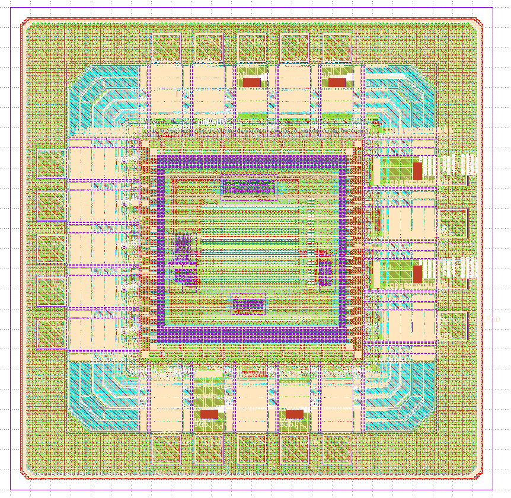

# IHP__SoC6169 — Reconfigurable XPCAM-Based In-Memory Computing for Binary Neural Networks

## Overview

**XPCAM** is a mixed-signal, 32 × 32 content-addressable memory (CAM) prototype designed for in-memory similarity evaluation and research on binary neural networks (BNNs). It combines a custom transistor-level CAM array with a programmable reference and time-domain sensing circuitry, allowing approximate matches to be evaluated without moving the stored words into a conventional digital processor.

The prototype targets the **IHP SG13CMOS5L 130 nm** technology and integrates the custom analog/CAM circuitry with digital control logic in a complete chip layout.

## Repository

- **Project repository:** https://github.com/EduHolg/IHP__SoC6169
- **IHP Open-Silicon MPW:** https://github.com/IHP-GmbH/Open-Silicon-MPW
- **Technology:** IHP SG13CMOS5L
- **IP identifier:** `IHP__SoC6169`

## Team

- **Design and implementation:** Emilio Yanchapaxi
- **Supervisors:** Eduardo Holguín and Esteban Garzón

## Project Description

XPCAM integrates three cooperating sections:

### 1. Content-Addressable Memory Array

The custom CAM core contains **32 words of 32 bits each**. Stored data is compared in parallel with an applied query. The transistor-level design includes the CAM cells, word-level structures, and match-line circuitry used to represent the comparison result.

Key schematic blocks include `CELL`, `WORD_32bits`, and `ARRAY_32x32`.

### 2. Programmable Reference and Time-Domain Sensing

A reconfigurable reference provides a comparison threshold for approximate matching. Rather than relying only on exact equality, the sensing circuitry compares the time-dependent responses of the CAM and reference paths. This enables similarity evaluation related to **XNOR/popcount and Hamming distance**, which is useful for binary neural network computations.

The associated custom blocks include the reference circuitry, sensing inverters, and comparison stages. The primary full-custom macro is named `COMPLETE_PROYECT_FIG` in the design files.

### 3. Digital Control and Chip Integration

Synthesizable digital logic manages addressing, serial data loading, reference configuration, write/search sequencing, and result readout. The repository includes modules such as `CAM_CONTROL`, `REFERENCE_MUX`, `SHIFT_5`, `decoder_5to32`, `shift_register_32`, and `OUTPUT`.

The full-chip design, named **`chip_top`** in the physical layout, integrates the CAM macro, digital logic, I/O pads, and chip-level physical structures using LibreLane.

## Macro Information

| Parameter | Description |
| --- | --- |
| Project name | Reconfigurable XPCAM-Based In-Memory Computing for Binary Neural Networks |
| IP repository | `IHP__SoC6169` |
| Type | Mixed-signal in-memory computing / CAM ASIC |
| Technology | IHP SG13CMOS5L, 130 nm |
| CAM organization | 32 × 32 bits, with programmable reference circuitry |
| Core supply | 1.2 V |
| I/O supply | 3.3 V |
| Documented full-chip dimensions | 1200 µm × 1200 µm (1.44 mm²) |
| Documented custom CAM macro dimensions | 415.39 µm × 367.22 µm |
| Physical top-level cell | `chip_top` |
| Custom CAM macro | `COMPLETE_PROYECT_FIG` |

The area and electrical values above describe the **design documentation**, not measured silicon characteristics. See the [datasheet](doc/Datasheet.md) and [specification](doc/Specification.md) for details.

## Top-Level Interface

The chip supports the following functional interface groups:

| Interface | Function |
| --- | --- |
| Clock and reset | Drive and initialize the digital control logic |
| Serial data/address input | Load row addresses, stored words, references, and search queries |
| Write, reference, and search controls | Select the requested CAM operation |
| Analog evaluation input | Provide the evaluation condition for the sensing circuitry |
| Serial result output | Read out the results of the CAM comparisons |
| Power and ground | Supply the core, I/O, and reference circuitry |

**For exact pad names, signal polarity, voltage limits, and operating sequences, use [doc/Datasheet.md](doc/Datasheet.md) and the [user guide](doc/CAM_User_Guide.pdf).** This table is a functional summary, not a pin-by-pin bonding specification.

## Operating Principle

1. **Program the memory:** Load a row address and data word, then initiate a write operation.
2. **Configure the reference:** Load the programmable reference used to determine the approximate-match criterion.
3. **Apply a query:** Supply the data word to compare against the stored CAM contents.
4. **Evaluate in parallel:** Match-line and reference responses are processed by the time-domain sensing circuitry.
5. **Read the result:** Digital control logic captures and serializes the comparison outcomes.

The reference settings allow the architecture to investigate Hamming-distance-based similarity for XNOR/popcount-oriented BNN operations. Functional examples and interface timing are documented in the datasheet.

## Repository Structure

| Directory | Contents |
| --- | --- |
| [`SoC6169-main/schematic/xschem/`](SoC6169-main/schematic/xschem/) | Transistor-level schematics and symbols |
| [`SoC6169-main/librelane/`](SoC6169-main/librelane/) | RTL, digital blocks, LibreLane configuration, and chip assembly |
| [`SoC6169-main/layout/klayout/`](SoC6169-main/layout/klayout/) | Physical layout and GDS files |
| [`SoC6169-main/netlist/`](SoC6169-main/netlist/) | SPICE and LVS reference netlists |
| [`SoC6169-main/testbenches/`](SoC6169-main/testbenches/) | Simulation testbenches and stimuli |
| [`SoC6169-main/verification/`](SoC6169-main/verification/) | DRC, LVS, and netlist-comparison reports |
| [`doc/`](doc/) | Datasheet, specification, user guide ([`CAM_User_Guide.pdf`](doc/CAM_User_Guide.pdf)), submission metadata, and TRL checklist |
| [`release/v.1.0.0/`](release/v.1.0.0/) | Versioned release documentation and fabrication deliverables |

### Layout Preview

## Design Status

The repository includes the custom CAM schematics, digital RTL, full-chip GDS layout, simulation files, and KLayout physical-verification reports. The previously reviewed full-chip **DRC and LVS logs report successful results**, but those reports are not equivalent to a completed foundry rejection test or fabrication approval.

Before final MPW acceptance, the versioned release files, submission metadata, applicable sign-off checks, and foundry review must be completed or confirmed. No post-fabrication measurement results are claimed here.

## License and Submission

The project is being prepared for IHP's **Standard Open-Source MPW** route under the **Apache License 2.0**. Any third-party PDK, pad-library, or other included material remains subject to its applicable redistribution terms.

- [IHP IP development instructions](https://github.com/IHP-GmbH/Open-Silicon-MPW/blob/main/IP-development-steps.md)
- [IHP submission process](https://github.com/IHP-GmbH/Open-Silicon-MPW/blob/main/Submission-process.md)
