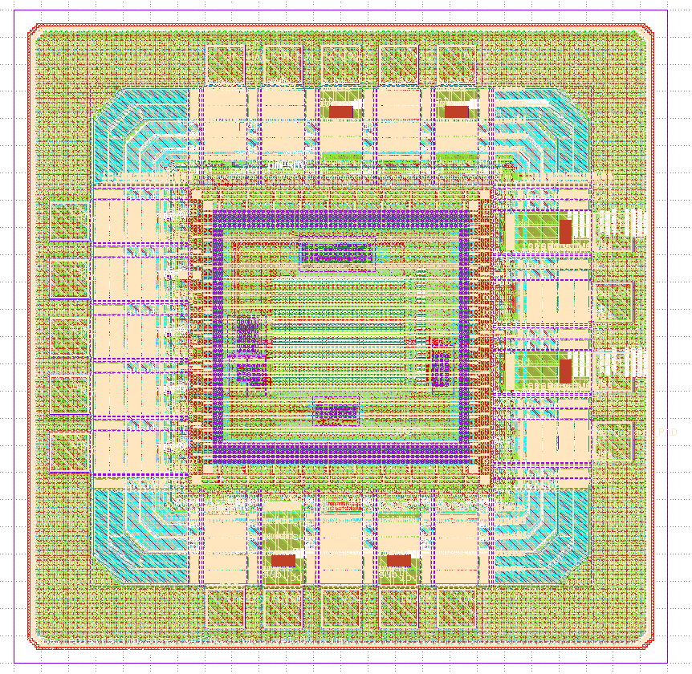
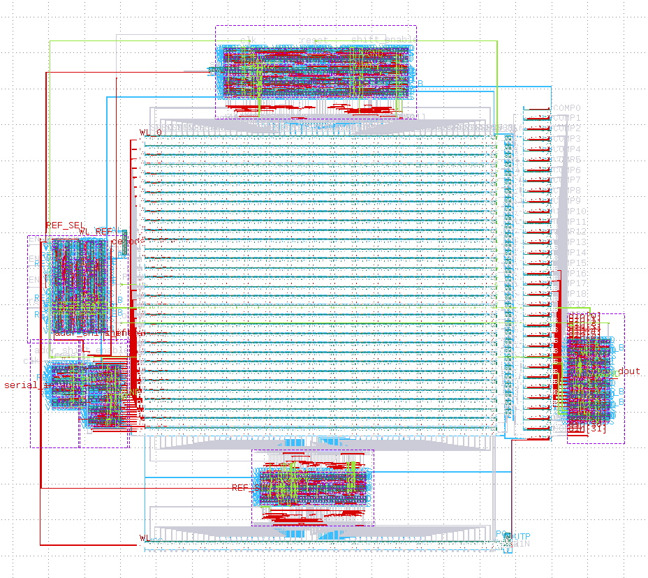
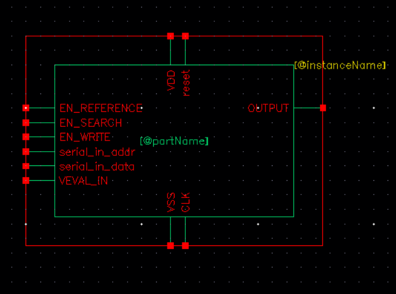

# Datasheet — Reconfigurable XPCAM-Based In-Memory Computing for Binary Neural Networks

Approximate content-addressable memory (CAM) of 32 words × 32 bits with a programmable Hamming-distance threshold, intended as an in-memory XNOR-popcount classifier for binary neural networks (BNNs).

| Item | Value |
|---|---|
| Technology | IHP SG13CMOS5L 130 nm (Metal1–Metal4 + TopMetal1 stack). Core in Metal1–Metal4; pad ring, power grid and seal ring up to TopMetal1. Core devices `sg13_lv_nmos` / `sg13_lv_pmos` |
| Supply | VDD = 1.2 V core (shared by digital and analog); IOVDD = 3.3 V pad ring |
| Clock | 100 MHz nominal (10 ns period), rising-edge |
| Memory | 32 words × 32 bits + 1 reference word |
| Match rule | word matches if Hamming distance to the query ≤ threshold |
| Threshold | programmed by writing the reference word (no ADC, no time-difference amplifier); characterized with VEVAL_IN = 0.5 V |
| Interface | serial in (data and address), serial out (1 bit per row), 3 operation-enable pulses |
| Pads (chip `chip_top`) | 19: 7 digital inputs, 1 digital output, 1 analog (VEVAL_IN), 3 VDD, 2 VSS, 3 IOVDD, 2 IOVSS |
| Pins (core `COMPLETE_PROYECT_FIG`) | 11: 8 digital signals + 1 analog input VEVAL_IN + VDD + VSS |
| Die size | 1200 µm × 1200 µm = 1.44 mm² (top cell `chip_top`, with pad ring and seal ring) |
| Core size | 415.39 µm × 367.22 µm ≈ 0.153 mm² (macro `COMPLETE_PROYECT_FIG`) |
| Physical verification | full chip and core: DRC clean and LVS clean (IHP SG13CMOS5L KLayout decks) |

*Full chip `chip_top`: pad ring, seal ring and fill around the CAM core.*

*Core `COMPLETE_PROYECT_FIG`.*

## 1. Pinout

### 1.1 Chip pads (`chip_top`)

| Pad | Side | IHP cell | Core pin | Notes |
|---|---|---|---|---|
| input_PAD[0] | West | IOPadIn | EN_WRITE | IOVDD-level input, shifted down to 1.2 V |
| input_PAD[1] | West | IOPadIn | EN_REFERENCE | same |
| input_PAD[2] | West | IOPadIn | EN_SEARCH | same |
| input_PAD[3] | South | IOPadIn | serial_in_addr | same |
| input_PAD[4] | North | IOPadIn | serial_in_data | same |
| rst_n_PAD | West | IOPadIn | reset | same; **active high** despite the pad name |
| clk_PAD | West | IOPadIn | CLK | same |
| output_PAD | East | IOPadOut30mA | OUTPUT | 1.2 V core signal shifted up to IOVDD, 30 mA driver |
| analog_PAD | North | IOPadAnalog | VEVAL_IN | no level shifting; ≈ 587 Ω series `rppd` + ESD diodes to IOVDD/IOVSS |
| VDD (×3) | East ×2, South | IOPadVdd | VDD | 1.2 V core supply |
| VSS (×2) | East, South | IOPadVss | VSS | core ground |
| IOVDD (×3) | North ×2, South | IOPadIOVdd | — | 3.3 V pad-ring supply |
| IOVSS (×2) | North, South | IOPadIOVss | — | pad-ring ground |

Digital pads use IOVDD levels (0–3.3 V CMOS). The analog pad passes VEVAL_IN (0.5 V) to the core unchanged; it supplies the V_EVAL driver, so decouple it close to the pad. Pad positions are listed in the top-level README.

### 1.2 Core pins (`COMPLETE_PROYECT_FIG`)

| Pin | Direction | Active | Function |
|---|---|---|---|
| VDD | Supply | — | 1.2 V for all logic and the analog core |
| VSS | Supply | — | Ground, 0 V |
| CLK | Input | rising edge | System clock, 100 MHz nominal (10 ns) |
| reset | Input | high | Returns the chip to idle and clears the internal registers |
| EN_WRITE | Input | high pulse | Starts writing one word into the row given by `serial_in_addr` |
| EN_REFERENCE | Input | high pulse | Starts programming the reference row (sets the threshold) |
| EN_SEARCH | Input | high pulse | Starts a search followed by the serial read-out of the result |
| serial_in_addr | Input | serial | 5-bit row address (0–31), MSB first |
| serial_in_data | Input | serial | 32-bit word, bit 31 first: data to write, reference word or query |
| OUTPUT | Output | serial | Search result, one bit per row, row 31 first. 0 = match, 1 = mismatch |
| VEVAL_IN | Input (analog) | — | External V_EVAL level, 0.5 V; supplies the inverter that drives the match-line evaluation footers |

At the core boundary all digital signal pins are CMOS 0–1.2 V; on the packaged chip the pads translate them to IOVDD levels. VEVAL_IN is an analog input (0.5 V).

### Pin details

- **CLK**: all registers and the control FSM use the rising edge. Functionality was verified at 100 MHz. Do not exceed this frequency: the internal pre-discharge, precharge and evaluation phases last a fixed number of clock cycles and would become shorter than validated. The clock must run during reset and during every operation.
- **reset**: active high. The control FSM goes to idle immediately (asynchronous reset) and the shift registers are cleared on the rising clock edges, so keep `reset` high for at least two clock cycles with CLK running. `OUTPUT` is 0 during reset. After a reset, rewrite the rows and the reference that will be used.
- **EN_WRITE / EN_REFERENCE / EN_SEARCH**:
  - Sampled on the rising edge of CLK while the chip is idle.
  - One pulse launches exactly one operation. Holding the pin high does not repeat it; the pin must go low and high again.
  - A pulse that arrives while another operation is running is ignored (no queue).
  - Priority if several arrive together: WRITE > REFERENCE > SEARCH.
- **serial_in_addr**: sent MSB first during the first five cycles of a write, in parallel with the first five data bits. Unused in the other operations.
- **serial_in_data**: 32 bits, bit 31 first, one bit per clock cycle. Data is presented in normal logic form: the chip adjusts internally the polarity required by the cells (an XNOR with the internal `REF_SEL` signal before the data shift register), so the user does not invert anything.
- **VEVAL_IN**: analog DC input, 0.5 V. It is the supply of the internal V_EVAL driver, so it sets the gate level of the match-line evaluation footers and therefore the discharge speed and the effective threshold. Apply it together with VDD and keep it constant; the threshold rule below is valid for 0.5 V.
- **OUTPUT**: during the read phase it delivers one bit per cycle from row 31 down to row 0. Outside the read phase it is 0. It is a combinational output: sample it in the middle of each cycle (falling edge of CLK). Rows that were never written return meaningless values.

## 2. Operations and timing

Serial inputs should change on the falling edge of CLK and are captured on the rising edge.

| Operation | Phase sequence | Cycles | Time @ 100 MHz |
|---|---|---|---|
| Write | 32 shift cycles (address in the first 5) + 1 setup + 1 WL pulse | 34 | 340 ns |
| Reference | 32 shift cycles + 1 setup + 1 WL_REF pulse | 34 | 340 ns |
| Search | 32 shift cycles + 1 pre-discharge + 1 precharge + 3 evaluation | 37 | 370 ns |
| Read | 1 output cycle per row, evaluation held | 32 | 320 ns |

A search followed by its read-out takes 69 cycles (690 ns).

Cycle-accurate protocol (E0 = rising edge on which the idle FSM sees `EN_*` = 1):

- Data/query bit *k* (k = 0…31, first bit sent = bit 31) is sampled at edge E(k+1).
- Address bit *k* (k = 0…4, MSB first) is sampled at edge E(k+1).
- WRITE / REFERENCE: the FSM is back in idle at E34; the next `EN_*` can be sampled from E35.
- SEARCH: with R = 37, `OUTPUT` = COMP[31 − j] is stable between E(R + j) and E(R + j + 1), j = 0…31. Idle at E(R + 32); next `EN_*` from E(R + 33).

## 3. Threshold programming

During a search the reference row is compared against the fixed pattern `0xFFFF0000`. The number of bits in which the stored reference word differs from that pattern sets how fast the reference match line discharges, and that instant (plus a fixed buffer delay) is the clock of the 32 capture flip-flops.

- Rows whose match line has already discharged at the capture instant → mismatch (1).
- Rows still precharged → match (0).

Because of the buffer delay, the effective threshold is below the number of differing bits of the reference. With the V_EVAL driver (VEVAL_IN = 0.5 V, typical corner) the rule is: match if HD ≤ m_ref − 4, where m_ref is the number of bits in which the reference differs from 0xFFFF0000.

| Reference word | Bits different from 0xFFFF0000 | Effective threshold (match if HD ≤) |
|---|---|---|
| 0xFFF8FFFF | 19 | 15 → HD ≤ 15 matches, HD ≥ 16 mismatches |

## 4. Verification results (transistor level, Spectre, lv MOS models shared by SG13G2 and SG13CMOS5L, 1.2 V, VEVAL_IN = 0.5 V, TT, 27 °C, 100 MHz)

Sequence: 6 writes, reference programming and one search with read-out (testbenches in `SoCXXXX-main/testbenches/`: `tran/` xschem/ngspice and `spectre/`). Query Q = `0x0000FFFF`, reference `0xFFF8FFFF` (19 bits).

| Row | Stored word | HD to Q | Expected | COMP / OUTPUT |
|---|---|---|---|---|
| 0 | 0x0000FFFF | 0 | match | 0 |
| 5 | 0x0000E000 | 13 | match | 0 |
| 13 | 0x00FF01FF | 15 | match | 0 |
| 20 | 0x00FF00FF | 16 | mismatch | 1 |
| 22 | 0x00030000 | 18 | mismatch | 1 |
| 31 | 0xFFFF0000 | 32 | mismatch | 1 |

All six rows were classified correctly, including the critical 15 vs 16 case, and the serial output delivered each row in its exact cycle.

## 5. Digital blocks (LibreLane, IHP sg13g2 standard cells)

Timing from the LibreLane runs (constrained at 5 ns, i.e. 2× the 10 ns used in the chip). Corners: typ 1.20 V 25 °C, slow 1.08 V 125 °C, fast 1.32 V −40 °C.

| Block | Die (µm) | Std cells | Cell area (µm²) | Worst setup slack | Worst hold slack | Power* | DRC / LVS / antenna |
|---|---|---|---|---|---|---|---|
| CAM_CONTROL | 75 × 70 | 150 | 2173.65 | 0.021 ns (slow) | 0.131 ns (fast) | 0.594 mW | 0 / 0 / 0 |
| shift_register_32 | 140 × 65 | 322 | 4156.79 | 1.944 ns (slow) | 0.225 ns (fast) | 0.421 mW | 0 / 0 / 0 |
| SHIFT_5 | 35 × 62 | 41 | 587.87 | 2.329 ns (slow) | 0.209 ns (fast) | 0.063 mW | 0 / 0 / 0 |
| decoder_5to32 | 34 × 75 | 86 | 702.17 | 4.234 ns | 3.892 ns | 0.006 mW | 0 / 0 / 0 |
| REFERENCE_MUX | 85 × 53 | 203 | 1589.41 | 4.692 ns | 3.885 ns | 0.024 mW | 0 / 0 / 0 |
| OUTPUT | 40 × 90 | 130 | 1322.70 | 0.878 ns (slow) | 0.172 ns (fast) | 0.073 mW | 0 / 0 / 0 |

\* OpenROAD estimate at the 5 ns constraint, typical corner. Total digital ≈ 1.18 mW at 200 MHz; lower at the 100 MHz operating clock.

No setup or hold violations in any corner. One max-fanout warning in CAM_CONTROL and one in shift_register_32.

## 6. Physical verification

| View | Check | Tool | Result |
|---|---|---|---|
| Full chip `chip_top` | DRC | KLayout 0.30.11, IHP SG13CMOS5L deck, table `main` + maximum rule set, recommended rules enabled | 0 errors |
| Full chip `chip_top` | LVS | KLayout 0.30.11, IHP SG13CMOS5L deck, flat (forbidden-layer check passed), `chip_top.gds` vs `chip_top_lvs.spice` | Netlists match, 0 warnings, 0 errors |
| Core `COMPLETE_PROYECT_FIG` | DRC | KLayout 0.30.11, IHP SG13CMOS5L deck, table `main` + maximum rule set | 0 errors |
| Core `COMPLETE_PROYECT_FIG` | LVS | KLayout 0.30.11, IHP SG13CMOS5L deck (forbidden-layer check passed), `COMPLETE_PROYECT_FIG.gds` vs `COMPLETE_PROYECT_FIG_lvs.spice` | Netlists match, 0 warnings |

GDS files in `SoCXXXX-main/layout/klayout/`, netlists in `SoCXXXX-main/netlist/schematic/`, logs in `SoCXXXX-main/verification/drc/` and `SoCXXXX-main/verification/lvs/` (one `*_run_<top cell>/` folder per view). Schematic vs. layout netlist (netgen): `SoCXXXX-main/verification/netgen/` — circuits match uniquely.

The chip-level LibreLane run (`SoCXXXX-main/librelane/chip_top/metrics.json`) also reports KLayout DRC 0, Netgen LVS 0 differences, 0 antenna violations (OpenROAD) and 0 power-grid violations.

## 7. Limitations and notes

- Results reported for the typical corner only; PVT corners and Monte Carlo are not included in this release.
- The effective threshold depends on VEVAL_IN (characterized only at 0.5 V), on the delay of the reference buffer and on the programmed reference; lower thresholds give slower discharge and need a longer evaluation window (`T_EVAL_MIN_PS` in `CAM_CONTROL`).
- The digital blocks were hardened without clock-tree synthesis (`RUN_CTS = false`).
- The transistor-level simulations cover the core only; the pads (level shifters, ESD, the ≈ 587 Ω series resistor on VEVAL_IN) are not included.
- The pad named `rst_n_PAD` carries the active-high `reset` of the core.
- The KLayout antenna check was disabled in the chip-level flow (IHP template default).
